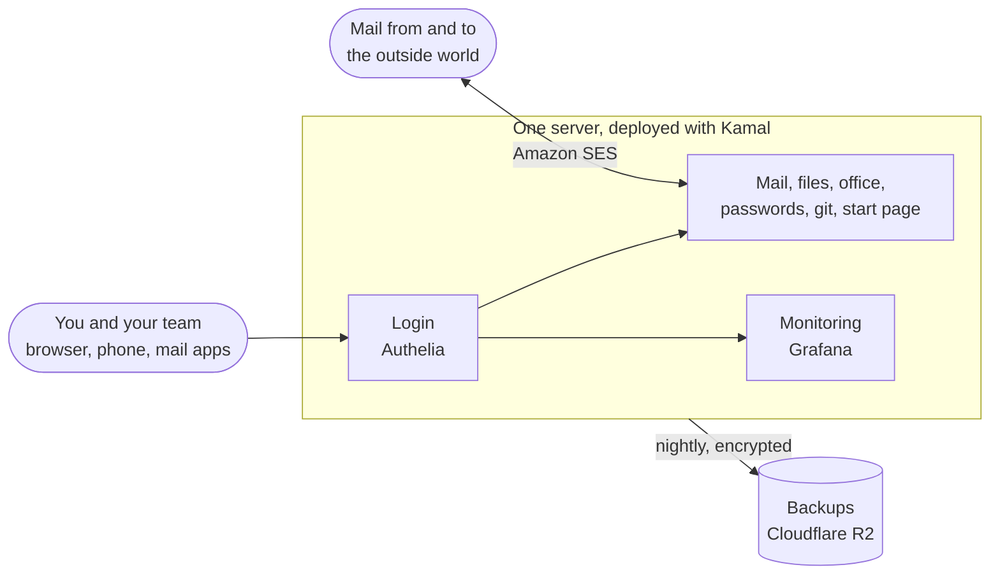

# SGNL

**Your company's own workspace, on one server you control.**
Mail, files and office documents, passwords, code, one login for all
of it, monitoring and encrypted backups. A self-hosted alternative to
Google Workspace or Microsoft 365, for a small team.

## The name

SGNL stands for **Secrétariat Général**. In French organisations, the
*secrétariat général* is the office that keeps the house running behind
the scenes: the correspondence, the records, the keys, the confidential
files. Nobody notices it when it works, and everything stops when it
doesn't. That is the job of this workspace.

It also reads as **signal**: clear information about what's going on,
instead of noise.

## Why it exists

SGNL started in October 2026 as a plan for a one-person consultancy
that didn't want to rent its workspace any more. Three ideas shaped it:

- **Cost that doesn't grow per person.** Mail, storage, office,
  passwords and login bought as separate subscriptions are "a few
  francs each" per user per month, and they add up quickly. On a server
  you already pay for, each extra person costs close to nothing.
- **Your data stays yours.** Mail, files and passwords live on your
  server, backed up encrypted to storage you own. No vendor can lock
  you out, read along, or change the terms.
- **Run by an agent, written down as code.** Every setting lives in this
  repository as configuration and small scripts, not in admin screens.
  So an AI agent (or a person) can read what is there, change it,
  and rebuild the whole thing from the backups if the server is lost.

It is deliberately boring: well-known open-source apps, one server,
no Kubernetes, nothing clever where something simple works.

## What you get

| | App | What it's for |
| --- | --- | --- |
| 🔑 | Authelia (our fork) | One login for everything, with passkeys |
| ✉️ | Stalwart + Bulwark | Your own mail server and webmail |
| 📁 | OpenCloud + Collabora | Files, sync, sharing, editing Word/Excel/PowerPoint in the browser |
| 🔒 | Vaultwarden | Password manager (works with the Bitwarden apps) |
| 🧑‍💻 | Forgejo | Git repositories, issues, pull requests |
| 📣 | listmonk | Mailing lists and campaigns, sent through Amazon SES |
| 🏠 | Dashy | A start page with every app, per person |
| 📈 | Grafana + VictoriaMetrics | Monitoring, logs and alerts |
| 💾 | restic → Cloudflare R2 | Nightly encrypted backups, with restore drills |

## How it fits together



Everyone signs in once, with a passkey, and every app trusts that
login. Mail goes in and out through Amazon SES, so a message is stored
safely even while the server is down. Every night the data goes,
encrypted, to off-site storage.

## Make it yours

Everything that belongs to one company (its domain, server, people,
start page) lives in a folder called `instance/`, kept in its own
private repository. This repository holds everything else and names no
real company. `instance.example/` is a complete example to start from.

```bash
git clone https://github.com/igorski89/sgnl && cd sgnl
cp -R instance.example instance    # then edit instance/sgnl.env
```

Then read, in this order:

1. [`docs/ARCHITECTURE.md`](docs/ARCHITECTURE.md): what runs and why it's built this way.
2. [`docs/DEPLOY.md`](docs/DEPLOY.md): setting it up, step by step.
3. [`docs/USERS.md`](docs/USERS.md): adding and removing people.
4. [`docs/BACKUPS.md`](docs/BACKUPS.md) and [`docs/RECOVERY.md`](docs/RECOVERY.md): backups, and rebuilding after losing the server.
5. [`docs/SECURITY.md`](docs/SECURITY.md): what each part exposes and how it's protected.

Fair warning: this is a working setup for a small team, not a
one-click product. Expect to read the docs, or to have an agent read
them for you.

## License

MIT, see [`LICENSE`](LICENSE).
